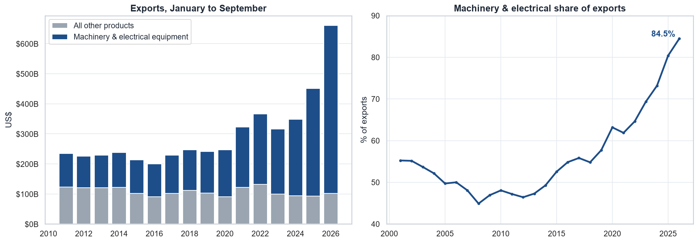
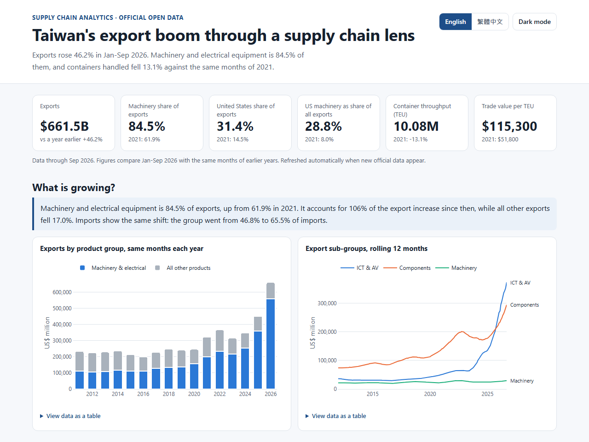
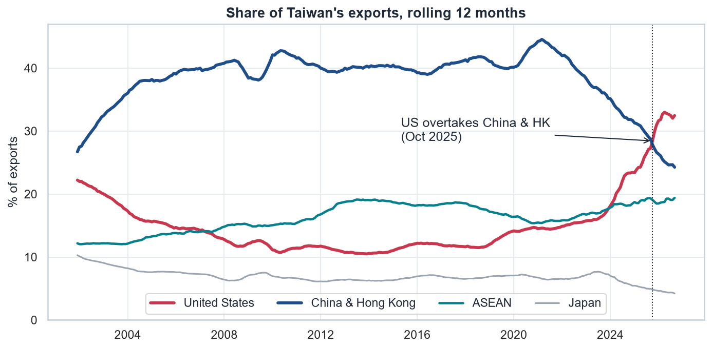
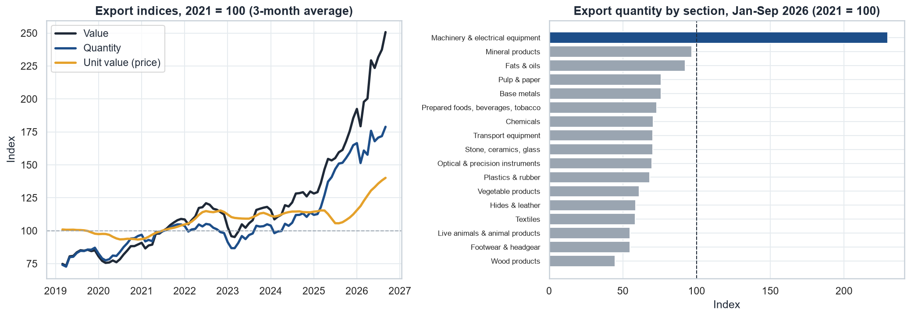
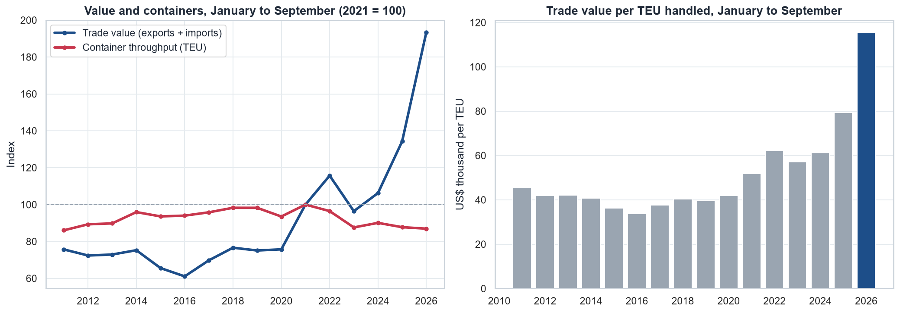

# Taiwan's Export Boom Through a Supply Chain Lens

[](https://github.com/Haven-Pham/taiwan-trade-supply-chain-analysis/actions/workflows/ci.yml)
[](https://haven-pham.github.io/taiwan-trade-supply-chain-analysis/)


**[Open the live dashboard](https://haven-pham.github.io/taiwan-trade-supply-chain-analysis/)** (English / 繁體中文), which updates when new official data appear.

## Overview

Taiwan's exports are at a record high. For someone planning capacity, inventory or suppliers, that headline raises a harder
question: is the whole supply chain busy, or only one part of it? This project combines official trade, price index and port
data from 2001 to September 2026 to separate value from volume, and one product group from everything else.

**Summary of results.** Exports reached US$661.5B in January to September 2026, up 46.2% on a year earlier. Machinery and
electrical equipment supplied 106% of the increase since 2021, because all other exports fell 17%. The US has replaced China &
Hong Kong as the largest market, yet the ports handled 13.1% fewer containers than in 2021 while trade value almost doubled. The
boom is real, but narrow, and a planner reading only the headline would misjudge demand in most sectors.



[](https://haven-pham.github.io/taiwan-trade-supply-chain-analysis/)

## Business Questions

1. Which products are behind the growth, and how concentrated have exports become?
2. Where are the goods going, and did the change of largest market reduce dependence?
3. Is the growth volume or price?
4. Do the ports see the boom, and can container counts still be read as a signal of trade?
5. Where do the inputs come from, and do imports give early warning of exports?
6. How much of total exports depends on a single trade lane?

## Approach

- **Like-for-like periods.** 2026 is a partial year, so every comparison uses January to September of each year. Crossovers use
  rolling 12-month totals, and count only when the lead has lasted through the latest month.
- **Checks before analysis.** Each breakdown is reconciled to the published total. Shares use the published total as the
  denominator, so unallocated values do not inflate them. Unallocated imports by country grew from 4.1% in 2021 to 12.2% in 2026,
  so country import shares are treated as lower bounds.
- **Concentration.** A Herfindahl-Hirschman Index is calculated across HS sections and across countries.
- **Volume against price.** Official chain indices split the change in value into quantity and unit value with a log
  decomposition.
- **Value against containers.** Trade value is compared with TEU, and year-on-year TEU is correlated with each trade series
  before and after 2020.
- **Exposure.** A first-order stress test sizes each lane's weight in total exports. It is an exposure measure, not a forecast.

## Key Findings

**One product group is the boom.** Machinery and electrical equipment went from 61.9% to 84.5% of exports. The product HHI rose
from 4,012 to 7,169, far above the market HHI of 1,452. Within the group, ICT and audio-visual products multiplied 6.6 times to
US$291.0B and passed electronic components on a rolling 12-month basis in October 2025. The official category cannot isolate
servers or AI hardware, so this project does not attribute the growth to them.

**The largest customer changed, and dependence on the product grew.** On a rolling 12-month basis the US overtook China & Hong
Kong in October 2025.

| Share of exports, Jan-Sep | 2021 | 2026 | Machinery in the market's basket, 2026 |
|---|---:|---:|---:|
| United States | 14.5% | 31.4% | 91.6% |
| China & Hong Kong | 42.7% | 24.2% | 85.4% |
| ASEAN | 15.9% | 20.2% | 84.7% |
| Japan | 6.6% | 4.2% | 70.0% |
| South Korea | 4.5% | 4.0% | 85.8% |
| Germany | 1.8% | 1.0% | 66.6% |



**Both volume and price rose, but volume rose in only one group.** Export value multiplied by 2.31, made up of quantity at 1.73
and unit value at 1.33, so volume explains about 65% of the change. Machinery quantity multiplied by 2.35. The other 16 indexed
product groups all ship less than in 2021, from 96.7 for mineral products to 44.9 for wood products (2021 = 100).



**Value and containers have separated.** Containers fell from 11.60M TEU to 10.08M TEU while trade value multiplied by 1.93. Trade
value per TEU went from US$51,840 to US$115,298. Since 2020, year-on-year TEU has tracked other exports (correlation 0.78) far
more closely than machinery exports (0.36). Before 2020 the two were 0.45 and 0.38. Container counts now describe the
traditional economy better than they describe the boom.



**Upstream sourcing moved too, but imports give no early warning.** Machinery rose from 46.8% to 65.5% of imports. South Korea
almost doubled its share of machinery imports (11.6% to 21.1%), and China & Hong Kong fell from 30.8% to 21.7%. The correlation
between machinery imports and exports is highest at zero lag (0.88), so aggregate imports do not lead exports.

**A single lane carries much of the risk.** Machinery to the US is 28.8% of all exports (US$190.4B). A fall of 10%, 20% or 30%
in that lane alone would remove 2.9%, 5.8% or 8.6% of total exports. For scale, in the 2023 downturn machinery exports fell 7.8%
and all other exports fell 24.4%.

## Recommendations

| Finding | Decision it informs |
|---|---|
| Growth comes from one product group | Do not read headline exports as demand for your sector. Plan non-electronics capacity on sector volumes |
| Value and containers have separated | Use TEU and quantity indices, not trade value, for ocean capacity and port planning |
| 16 of 17 product groups ship less than in 2021 | Traditional exporters, and the carriers serving them, face soft volumes despite record trade |
| US machinery is about 29% of exports | Electronics supply chains need scenario plans for this lane: tariffs, demand and logistics disruption |
| South Korea's share of machinery imports almost doubled | Review supplier concentration in electronic inputs |
| Aggregate imports do not lead exports | Do not use total machinery imports as an early-warning indicator |

## Deliverables

- [Live dashboard](https://haven-pham.github.io/taiwan-trade-supply-chain-analysis/): KPIs, charts, a trade-lane scenario tool
  and a table view of every chart, in English and Traditional Chinese.
- [Analysis notebook](notebooks/taiwan_trade_supply_chain.ipynb): the full analysis with its reasoning and limitations.
- [Excel workbook](reports/Taiwan_Trade_Supply_Chain_Results.xlsx): a summary sheet and 14 result tables.
- [Figures](reports/figures) and [CSV tables](reports/tables).

## Repository Structure

```
├── dashboard/        Static dashboard: page, styles, script, data.json, self-hosted Plotly
├── data/raw/         Official files as downloaded, through September 2026
├── notebooks/        Analysis notebook, with outputs
├── reports/          Excel workbook, figures and tables
├── scripts/          Download, run notebook, build workbook, build dashboard data
├── src/taiwan_trade/ Source list, data loading and metrics
├── tests/            Unit tests for parsing and metrics
└── .github/workflows CI, and the dashboard refresh and deployment
```

## Reproducing

```bash
pip install -r requirements.txt
python -m pytest -q
python scripts/run_notebook.py
python scripts/build_excel_report.py
python scripts/build_dashboard.py
python -m http.server --directory dashboard
```

The notebook is pinned to the committed snapshot through September 2026, so its numbers match this README. The dashboard follows
the latest month instead. Twice a month a workflow downloads the official files into a separate folder and rebuilds only
`dashboard/data.json`. It stops at the last month that every source covers, and if a source fails, the last good data stay online.

## Data

Official open data from the Ministry of Finance (trade totals, HS sections, country and market tables, chain indices) and Taiwan
International Ports Corporation (TEU by port), through [data.gov.tw](https://data.gov.tw), under the Open Government Data License
version 1.0. See [data/README.md](data/README.md) for each dataset. The dashboard bundles
[Plotly.js](https://github.com/plotly/plotly.js) (MIT).

## Limitations

- **Quantity is not weight.** Quantity indices measure volume change and are not tonnes.
- **Value per TEU mixes modes.** Trade value includes air freight and TEU counts sea containers only. The measure shows that the
  two have separated, and does not describe what is inside a container.
- **The air freight explanation is untested.** A shift to air would explain part of the gap, but the open monthly Taoyuan airport
  cargo file ends in 2022.
- **Unallocated imports.** 12.2% of 2026 imports have no listed country, almost all within the Asia subtotal. The source does not
  explain why.
- **Broad categories.** HS sections and official sub-groups cannot isolate servers, chips or specific supply chains.
- **Correlation only.** The coupling and lead-lag results describe co-movement over limited periods and do not prove cause.
- **Partial year and revisions.** 2026 covers January to September, and recent official figures may be revised.

## 繁體中文摘要

本專案整合財政部進出口統計與臺灣港務公司貨櫃資料，從供應鏈角度檢視臺灣出口榮景。2026 年 1 至 9 月出口達 6,615 億美元，年增 46.2%；
機械及電機設備占出口 84.5%，貢獻 2021 年以來出口增額的 106%，其他貨品出口則下降 17%。美國已取代中國大陸及香港成為最大市場，但貨櫃量較
2021 年同期下降 13.1%，貿易值卻增為 1.93 倍。對美機械及電機設備占總出口 28.8%，該路線下跌 20% 將使總出口減少約 5.8%（此為曝險衡量，並非預測）。
歡迎參閱[互動式儀表板](https://haven-pham.github.io/taiwan-trade-supply-chain-analysis/?lang=zh)。

## Author

Pham Hong Hieu (Haven) · [Portfolio](https://haven-portfolio02.vercel.app) · [LinkedIn](https://www.linkedin.com/in/havenpham) · [GitHub](https://github.com/Haven-Pham)
